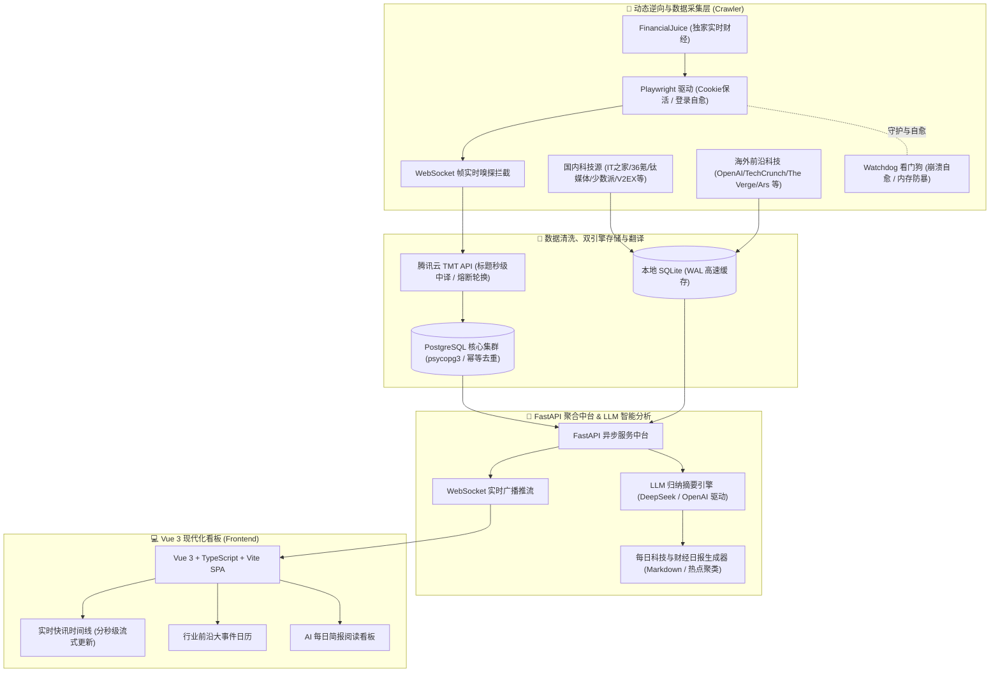

# TechPulse (AI Financial & Tech Intelligence Platform)

> **企业级科技与突发财经情报全栈系统**：融合 **高可用逆向爬虫**、**多源聚合引擎**、**大模型 (LLM) 智能摘要归纳** 与 **Vue 3 现代化响应式看板** 的端到端开源全栈解决方案。

[](https://www.python.org/)
[](https://fastapi.tiangolo.com/)
[](https://vuejs.org/)
[](https://playwright.dev/)
[](https://www.postgresql.org/)
[]()

---

## 🌟 系统架构总览



---

## 📁 模块结构

```text
.
├── backend/                   # FastAPI 业务中台与 LLM 智能摘要引擎
│   ├── app/
│   │   ├── ingest/            # 多源采集调度器 (RSSHub / HTTP / 代理池适配)
│   │   ├── summary_service.py # LLM 驱动的每日新闻总结与关键事件提取
│   │   ├── fj_read.py         # FinancialJuice 高并发只读适配层
│   │   ├── news_ws.py         # 全双工 WebSocket 实时推送
│   │   └── main.py            # FastAPI 入口与 SPA 静态托管
│   ├── data/
│   │   ├── events_cn.yaml     # 预置科技与大事件日历
│   │   └── summaries/         # 历史 LLM 生成的每日 Markdown 研报归档
│   ├── tests/                 # 后端单元测试
│   └── pyproject.toml
│
├── frontend/                  # Vue 3 现代化响应式情报监控看板
│   ├── src/
│   │   ├── views/             # 核心视图 (时间线、大事件日历、AI简报、信源管理)
│   │   ├── composables/       # 组合式 API (WebSocket 断线自动重连)
│   │   ├── api/               # RESTful 强类型 API Client
│   │   └── App.vue
│   ├── package.json
│   └── vite.config.ts
│
├── crawler/                   # Playwright 高可用金融快讯采集节点
│   ├── app/
│   │   ├── browser/           # Playwright 无头上下文、Cookie 保活、WS 拦截器
│   │   ├── robot/             # 采集任务状态机与 Watchdog 看门狗自愈守护
│   │   ├── services/          # 实时 WebSocket 监听、轮询兜底与历史翻页抓取
│   │   ├── storage/           # 仓储抽象层 (PostgreSQL / SQLite 双引擎适配)
│   │   └── gui/               # 极简内置轻量控制台
│   ├── scripts/               # 数据库一键全量迁移脚本 (SQLite -> PG)
│   ├── tests/                 # 采集器与断点恢复测试
│   └── pyproject.toml
│
├── deploy/                    # 生产环境运维编排
│   ├── crawler/               # 采集服务与翻译服务的 Systemd 单元
│   │   ├── getnews.service
│   │   └── getnews-translate.service
│   └── tech-pulse/            # 后台服务的启动/停止脚本与 Systemd 配置
│       ├── start.sh
│       └── stop.sh
│
├── .gitignore                 # 严苛的数据安全与脱敏规则
└── README.md                  # 项目总览文档
```

---

## ⚡ 核心技术特性

### 1. 工业级抗反爬采集与自愈看门狗 (`crawler/`)
- **Playwright 会话保活**：针对登录鉴权站点，通过注入 `MutationObserver` 实时监听登出弹窗并秒级自动重登；支持 Cookie/StorageState 持久化保存。
- **WebSocket 逆向嗅探**：通过网络底层监听拦截服务端的实时数据帧，达到比轮询接口快数秒的极致时效性。
- **Watchdog 双层自愈**：主看门狗实时监测采集协调器 PID，崩溃毫秒级拉起；周期性安全重启防止 Chromium 内存泄露；采集状态机支持精确到 NewsID 的断点续传。

### 2. 双引擎存储与毫秒级机器翻译
- **双数据库引擎**：支持无依赖本地 **SQLite (WAL 模式)** 与生产级 **PostgreSQL**，利用 `ON CONFLICT (news_id) DO UPDATE` 保证高并发写入时的幂等性与字段增量修补。
- **腾讯云 TMT 即时翻译**：入库同时触发异步标题中译，内置双密钥自动轮转与配额熔断保护。

### 3. 多源科技新闻聚合与 LLM 智能研报 (`backend/`)
- **多源智能调度**：串行锁调度管理数十个国内外科技源（IT之家、量子位、钛媒体、Solidot、OpenAI、TechCrunch 等），国内源优先直连，海外源智能调度代理重试。
- **LLM 自动化日报归纳**：集成大语言模型，自动聚类当日科技重大事件与国际财经异动，自动生成 Markdown 结构化日报（包含一句话速览、核心数据解读、科技突破、舆情热点）。

### 4. 高响应式现代全栈看板 (`frontend/`)
- **Vue 3 + TypeScript + Vite** 构建，单页应用设计。
- 支持全双工 **WebSocket 实时推流**，新新闻毫秒级无感滚入时间线；内置大事件日历、信源健康度与 AI 研报直接阅读。

---

## 🚀 快速上手

### 1. 启动采集端 (Crawler)

```bash
cd crawler
python -m venv .venv
source .venv/bin/activate
pip install -e .
python -m playwright install chromium

# 方式一：生产看门狗无头模式常驻
python -m app.robot.watchdog

# 方式二：开发或监控模式（内置 Web 状态看板）
python -m app.gui.server
```

### 2. 启动中台与 AI 后端 (Backend)

```bash
cd backend
python -m venv .venv
source .venv/bin/activate
pip install -e .

# 启动 FastAPI 聚合服务
uvicorn app.main:app --host 0.0.0.0 --port 8088 --reload
```

### 3. 启动前端监控看板 (Frontend)

```bash
cd frontend
npm install
npm run dev
# 浏览器访问 http://localhost:5173
```

---

## 🛠️ 生产环境部署

在 Linux 服务器中，推荐使用 `deploy/` 下的 Systemd 单元常驻运行：

```bash
# 1. 部署采集守护服务 (使用虚拟显示屏 xvfb-run 无头运行)
sudo cp deploy/crawler/*.service /etc/systemd/system/
sudo systemctl daemon-reload
sudo systemctl enable --now getnews
sudo systemctl enable --now getnews-translate

# 2. 启动 TechPulse 后台服务
cd deploy/tech-pulse
./start.sh
```

---

## 🔒 安全与隐私声明

- 敏感凭据（如 `.env`、API 密钥、数据库连接串、本地 Cookie 凭据）严格受到根目录 `.gitignore` 保护，切勿提交至公网仓库。
- 生产部署请务必修改 `backend/data/access.env` 中的 `TECHPULSE_ACCESS_KEY` 以启用访问鉴权。

---

## 📄 开源许可证

本项目采用 [MIT License](LICENSE) 授权许可。
